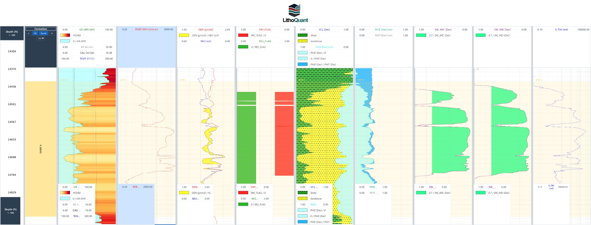
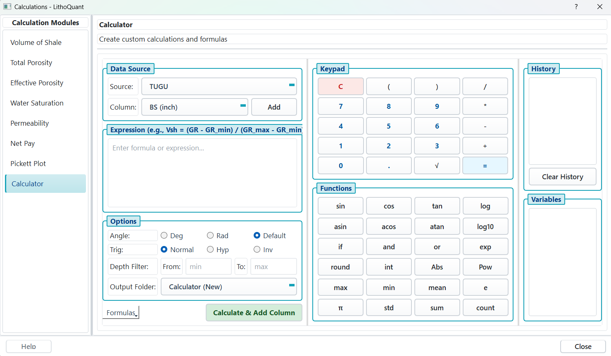
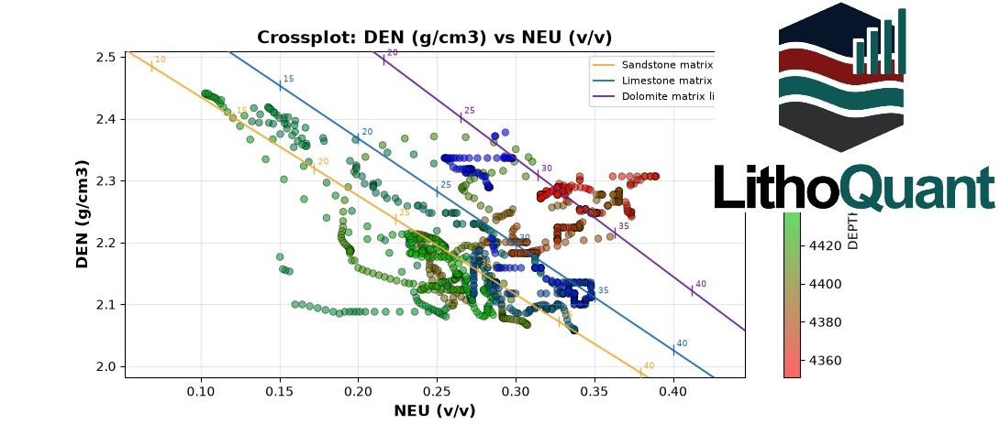

# LithoQuant Website

<p align="center">
  
  <br />
  <em>Educational and Commercial Petrophysical Analysis Software</em>
</p>

<p align="center">
  <a href="https://github.com/LithoQuant/LithoQuant"></a>
  <a href="#"></a>
  
  
</p>

Website for LithoQuant, a desktop application for petrophysical well log analysis. This site presents the software, its workflow, and the team behind it.

## Preview

Run locally and open `http://localhost:8000`:

```bash
bash scripts/start-server.sh
```

No build step is required. Any static server will work.

## Screenshots

| Track Display | Petrophysical Calculations | Crossplot |
|---|---|---|
|  |  |  |

## Why LithoQuant

**From LAS to decision in minutes.** LithoQuant combines visualization, calculation, and quality control in one intuitive interface built for petroleum engineers and geoscientists.

* **Visualize** multi-track logs with drag and drop, zoom, pan, and crossover shading
* **Calculate** Vshale, porosity, water saturation, permeability, and net pay with audited methods
* **Assure quality** with histograms, crossplots, and outlier and gap analysis
* **Edit and manage** data with 20-level undo, smoothing, despiking, and auto-save projects

## Highlights

Twelve core capabilities organized around how you work:

**Core** - Visualization, Petrophysical Calculations, Quality Control, Data Editing  
**Scale** - Multi-Well Analysis, Project Management, Export, Well Deviation 3D  
**Science** - Live Drilling Feed, Geomechanics 1D MEM, Rock Physics Template, GWD Chromatography

All calculations are logged with a SHA-256 audit trail.

## Pages

* **Home** (`index.html`) - Hero, features, application interface, download, and about
* **Gallery** (`gallery.html`) - Event photos
* **News** (`news.html`) - Release notes
* **Developer** (`developer.html`) - Current team, past contributors, advisors, partners

## Technology

* Semantic HTML5
* Modular CSS with custom properties, no framework
* Vanilla JavaScript, no framework
* Font Awesome 6.4.0 and Inter / JetBrains Mono via Google Fonts

## Getting Started

### Requirements

Any modern browser. For local preview, Python 3 is recommended.

### Run

```bash
# Linux / macOS
bash scripts/start-server.sh
# Windows
scripts\start-server.bat

# Alternative direct Python
python3 -m http.server 8000
```

Then visit `http://localhost:8000`.

### Structure

```
.
├── index.html
├── gallery.html
├── news.html
├── developer.html
├── sitemap.xml
├── robots.txt
├── assets/
│   ├── css/        # base, layout, components, sections, pages
│   ├── js/         # script.js, tabs.js
│   └── images/     # branding, screenshots, gallery, partners
├── components/     # navbar, footer, head partials
└── scripts/        # start-server.sh / .bat
```

See `assets/css/README.md`, `assets/js/README.md`, and `assets/images/README.md` for details.

## Customization

**Theme colors** in `assets/css/base/variables.css`:

```css
:root {
  --primary-color: #2563eb;
  --secondary-color: #10b981;
  --accent-color: #f59e0b;
}
```

**Add a screenshot:** place the file in `assets/images/screenshots/` using `kebab-case` (for example `new-feature.jpeg`) and reference it in HTML.

**Add a page:** copy `gallery.html` as a template, create `assets/css/pages/newpage.css`, import it in `assets/css/style.css`, and add the URL to `sitemap.xml`.

## Deployment

The site is static. Deploy the repository contents to any static host, such as GitHub Pages. Ensure `sitemap.xml` and `robots.txt` remain at the root.

## Contributing

Contributions to the website are welcome. Whether you fix a typo, improve accessibility, or add a new section, every pull request matters.

### How to Contribute

1. **Fork and clone**

   ```bash
   git clone https://github.com/LithoQuant/Web-LithoQuant
   cd Web-LithoQuant
   ```

2. **Create a branch**

   ```bash
   git checkout -b feat/your-feature
   ```

3. **Run locally**

   ```bash
   bash scripts/start-server.sh
   # open http://localhost:8000
   ```

4. **Make your change** - keep it modular. Edit `assets/css/` or `components/` and keep `assets/js/script.js` lean.

5. **Test** - verify no broken `href` or `src`, check layouts at 968px and 640px, and run `python3 -m http.server 8000` for a final check.

6. **Commit and open a PR** - push your branch and open a pull request with a clear description and a screenshot or GIF if the change is visual.

### Guidelines

* Keep HTML semantic and accessible. Provide `alt` text and `aria-label` where needed.
* Use design tokens in `assets/css/base/variables.css`. Avoid hard-coded colors.
* Prefer editing an existing module over adding a new file. Search for dead code with `grep` before adding.
* Images: use `kebab-case`, JPEG for photos and SVG for vectors, compress before committing.
* Do not use em dash. Use hyphen `-`.
* Keep the tone concise, professional, and in English.

### Need Help

* Look for `good first issue` labels.
* Open an issue contact the maintainer at `kadek.palgunadi@its.ac.id`.
* By contributing you agree to a basic code of conduct: be respectful, be precise, and be helpful. All web pull requests are reviewed. Direct pushes to `main` are not allowed. Note that the website code is open for contributions, while the LithoQuant desktop software itself remains proprietary.

## License

Copyright (c) 2024-2026 LithoQuant. All rights reserved. This website and its assets are proprietary.

---

<p align="center">
  Built with care for the petroleum industry<br />
  Geophysical Engineering, Institut Teknologi Sepuluh Nopember
</p>
